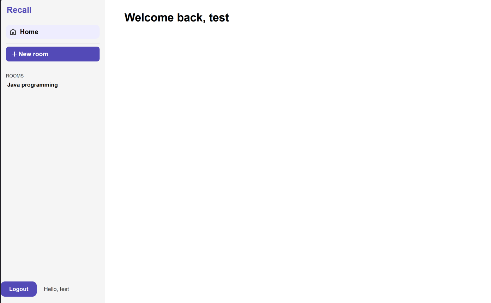
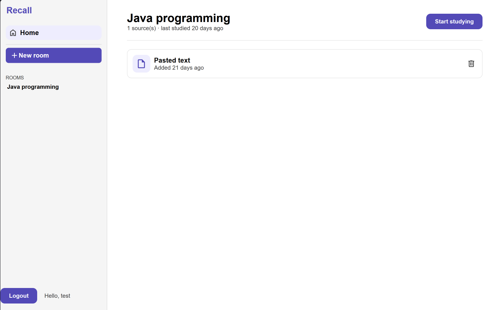
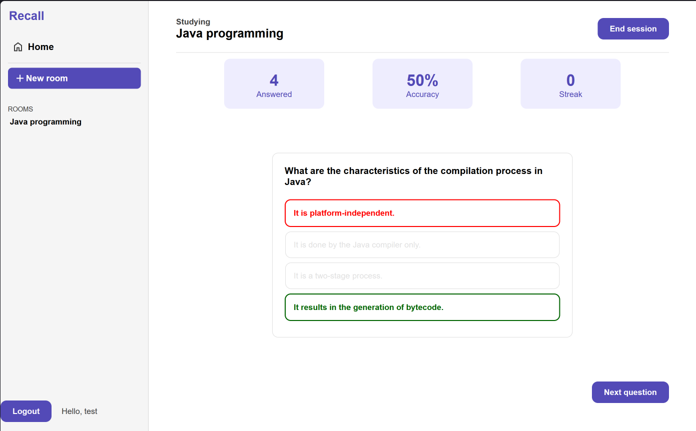
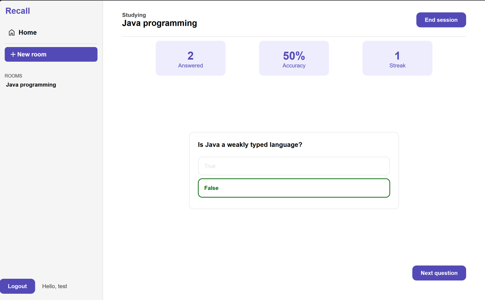
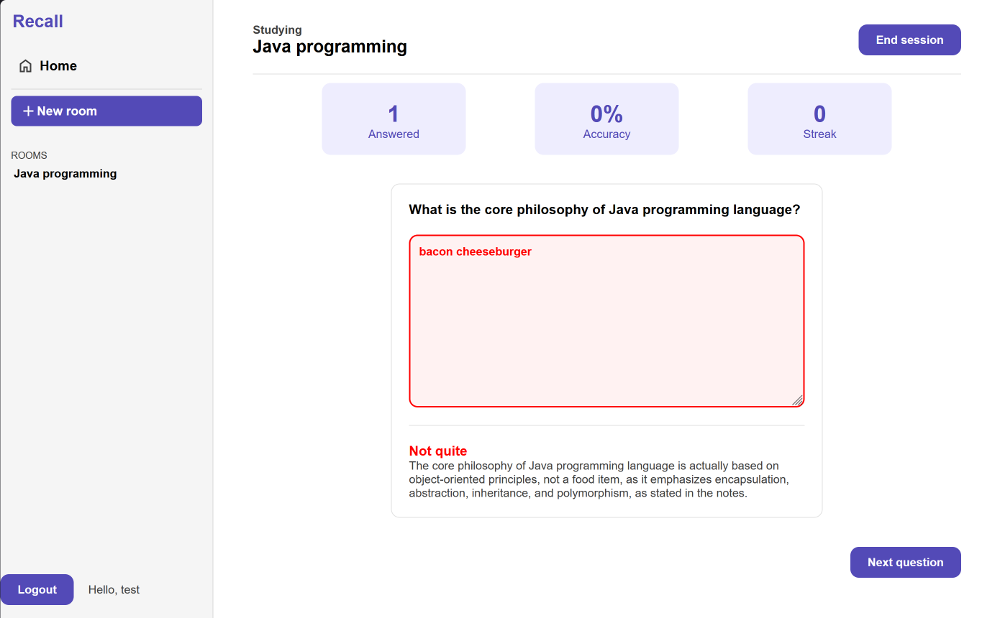
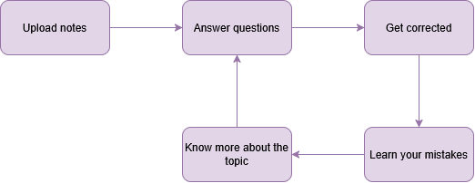

# Recall - Study platform

Recall is a study platform which allows students to convert their class notes into an infinite quiz to help them study.

Home page (WIP)

Rooms

Multiple-option question, answered incorrectly

True/false question, answered correctly

Text question, answered incorrectly

View more images [here](screenshots.md)

## Stack used
- Frontend: Astro
- Backend: Java (Spring Boot)
- Database: MariaDB
- AI: Ollama

## Project status
Work in progress. Recall is self-hosted and hasn't been tested with outside users yet, so there's no public demo.
There is also no mobile UI.

## How the app works
### A few definitions
- Room: Location where documents are stored. Think of this as an actual room, where you store your notes, documents, or anything to help you learn and study.
- Study session: Where the user answers questions and gets them graded

Users can paste in their class notes or upload documents to create a room. Once the room is created, the user can start a study session. This study session has analytics and tracks how many questions were generated, how many were answered, and what streak the user currently has. Once the session ends, those analytics are stored in the database and displayed to the user. The user can then restart their study session or change topics and learn more about it, which closes the learning loop. Basically:

 />

If the user quits during a study session, attempting to start a new one will simply redirect the user to the old one, preventing duplicate/ghost sessions.

## Technical notes
- Rather than use server-side session tokens for authentication, I decided to go with JWT tokens. This makes the backend scalable and avoids making unnecessary database calls to validate the user is authenticated. To prevent tokens from being seen by scripts, it is stored in an HttpOnly cookie. This also makes the JWT token impossible to revoke, so the cookie lasts for 15 minutes before expiring in order to prevent encountering issues with that.
- I included previously answered in the prompt so the model knows which ones have already been asked and doesn't generate duplicate questions.

## Contact
Interested in learning more or checking out the source code? Contact me on [my website](https://nebu.me)!